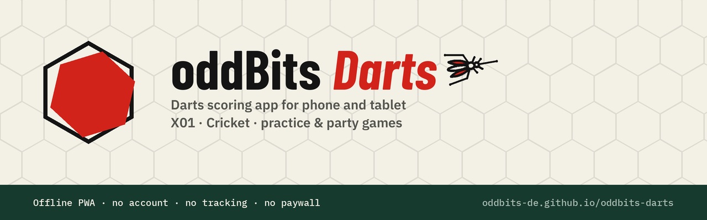

# oddBits Darts

Darts scoring app: X01, Cricket, practice and party games. Checkout suggestions, stats and team play. Offline PWA that runs entirely in your browser, no account, no tracking, no paywalled features. All data stays on your device.

**Try it:** https://oddbits-de.github.io/oddbits-darts/

> Test version (below v1.0). Feedback and bug reports are welcome via [Issues](https://github.com/oddbits-de/oddbits-darts/issues).

## Features

- **Match:** X01 (301/501/701, single/double in, single/double/master out, legs and sets), Cricket (standard and cut-throat)
- **Practice:** Around the Clock, doubles round, Bob's 27, 121, random checkout
- **Party:** Shanghai, Killer, Halve-It, Golf, Bowling
- Input per dart or as a visit total, unlimited undo
- Checkout suggestions that fit your remaining darts, favourite double
- Statistics per person: average, first 9, checkout rate, 180s, best leg and more
- Teams and doubles for X01 and Cricket, with stats per team and per person
- Works offline and can be installed to the home screen, light/dark mode, English and German

## Privacy

Everything runs locally in your browser. Names, settings and game history are stored only on your device (localStorage/IndexedDB) and are never sent anywhere. No account, no analytics, no external requests. You can back up, restore or delete all data in the settings.

The app is hosted on GitHub Pages, so GitHub processes the usual server logs (e.g. IP address) when the page is loaded.

## Licence

No open-source licence yet: you're welcome to use the app and read the code, but please don't redistribute or reuse it without permission. The bundled fonts (Barlow Condensed, IBM Plex Sans/Mono) are licensed under the SIL Open Font License, see `fonts/`.

## About

Crafted with AI, coffee, and common sense. © [oddBits.de](https://oddBits.de)

---

# oddBits Darts (Deutsch)

Darts direkt am Board zählen: X01, Cricket, Trainings- und Partyspiele. Checkout-Vorschläge, Statistik und Team-Spiel. Offline-PWA, läuft komplett im Browser, ohne Konto, ohne Tracking, ohne kostenpflichtige Zusatzfunktionen. Alle Daten bleiben auf deinem Gerät.

**Ausprobieren:** https://oddbits-de.github.io/oddbits-darts/

> Testversion (unter v1.0). Rückmeldungen und Fehlermeldungen gern über [Issues](https://github.com/oddbits-de/oddbits-darts/issues).

## Funktionen

- **Spiele:** X01 (301/501/701, Single/Double-In, Single/Double/Master-Out, Legs und Sets), Cricket (Standard und Cut-Throat)
- **Übungsmodi:** „Around the Clock“, Doppelrunde, „Bob’s 27“, 121, zufälliger Checkout
- **Party:** Shanghai, Killer, Halve-It, Golf, Bowling
- Eingabe pro Dart oder als Gesamtpunktzahl pro Runde, unbegrenztes Rückgängigmachen
- Checkout-Vorschläge passend zu deinen verbleibenden Darts, Lieblingsdoppel
- Statistiken pro Person: Durchschnitt, erste 9, Checkout-Quote, 180er, bestes Leg und mehr
- Teams und Doppel für X01 und Cricket, mit Statistiken pro Team und pro Person
- Funktioniert offline und kann auf dem Startbildschirm installiert werden, Hell-/Dunkelmodus, Englisch und Deutsch

**Datenschutz:** Alles läuft lokal im Browser. Namen, Einstellungen und Spielverlauf werden nur auf deinem Gerät gespeichert und nirgendwohin gesendet. Die App liegt auf GitHub Pages, deshalb verarbeitet GitHub beim Aufruf die üblichen Server-Protokolle (z. B. IP-Adresse).

Impressum und Datenschutzerklärung: https://oddbits.de/impressum/ · https://oddbits.de/datenschutzerklaerung/

Mit KI, Kaffee und Köpfchen erstellt. © [oddBits.de](https://oddBits.de)
